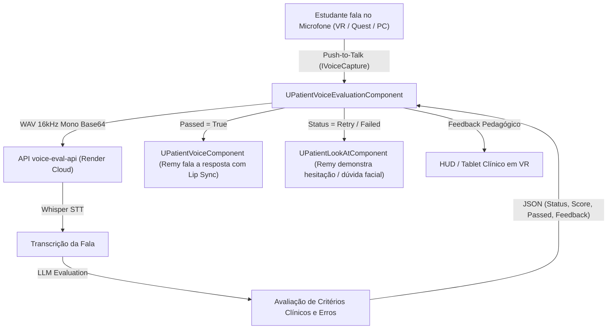

# 🎙️ Integração de Voz e Avaliação Clínica com IA (voice-eval-api)

Este módulo substitui o quiz estático de múltipla escolha (`BP_Quiz`) por uma **interação por voz direta com o paciente Remy em Realidade Virtual**, utilizando inteligência artificial para transcrição e avaliação clínica em tempo real.

---

## 1. Visão Geral da Arquitetura

---

## 2. Componente C++ Nativo: `UPatientVoiceEvaluationComponent`

O componente está adicionado diretamente ao blueprint do paciente (`BP_Patient`) e compilado no módulo `MedicalGestureLib`.

### Propriedades Principais:
- **`BaseUrl`**: `"https://voice-eval-api.onrender.com"`
- **`ApiKey`**: `"wcP90Sipv_00QbUM8O_NBDsALc76AJSX6bt1A2aXLtg"`
- **`ScenarioId`**: `"coleta-sangue"`
- **`bAutoWakeUpServerOnStart`**: `true` (Dispara um `GET /health` no `BeginPlay` para aquecer o container do Render, eliminando atrasos).
- **`bAutoAdvanceOnPass`**: `true` (Avança para a próxima etapa clínica automaticamente quando o estudante atinge os critérios).
- **`bAutoTriggerPatientResponse`**: `true` (Faz o Remy responder falando com sua voz neural e lip sync sincronizado).
- **`MicInputLevel`**: Flutuante de 0.0 a 1.0 indicando a intensidade da voz para alimentar barras de volume em VR.

### Funções Blueprint:
- **`StartRecording()`**: Começa a capturar o microfone (ligar no evento *Pressed* do botão de voz, ex: Grip/Trigger secundário do controle VR).
- **`StopRecording()`**: Finaliza a gravação, empacota o WAV em Base64 e envia para a API.
- **`CancelRecording()`**: Cancela a gravação sem enviar.
- **`EvaluateText(FString TranscriptText)`**: Envia texto diretamente (ótimo para testes rápidos no editor sem microfone).
- **`WakeUpServer()`**: Envia ping de aquecimento para acordar o servidor na nuvem.
- **`AdvanceToNextQuestion()`**: Avança manualmente para a próxima pergunta.
- **`SetCurrentQuestionById(FString QuestionId)`**: Pula para uma etapa específica.

### Eventos (Dispatchers):
- `OnRecordingStarted`: Disparado ao começar a falar (exibir ícone de microfone ativo).
- `OnRecordingStopped`: Disparado ao soltar o botão.
- `OnEvaluationStarted`: Disparado enquanto a API processa (exibir "Analisando sua resposta...").
- `OnEvaluationCompleted(Result)`: Retorna transcrição, nota (0 a 1), feedback pedagógico e detalhe de critérios.
- `OnServerWakeUp(bIsAwake, LatencyMs)`: Confirmação de que o servidor está pronto.
- `OnQuestionChanged(QuestionId, Hint)`: Notifica nova instrução para o estudante.

---

## 3. Mapeamento das Etapas Clínicas (`coleta-sangue`)

| ID da Pergunta | O que o Aluno Deve Fazer | Resposta Falada do Remy (`DT_FalasPaciente`) |
| :--- | :--- | :--- |
| **`apresentacao`** | Apresentar-se (nome e função) e perguntar como o paciente está se sentindo. | `P1_acolhimento` (*"Bom dia! Ah, eu tô bem, sim... só um pouquinho ansioso..."*) |
| **`identificacao-paciente`** | Perguntar o nome completo e data de nascimento de forma aberta. | `P2_nome_data` (*"É José Carlos da Silva. Nasci no dia 14 de março de 2002."*) |
| **`alergias`** | Investigar alergias a antissépticos (álcool, iodo, clorexidina) e látex da luva. | `P3_alergia_completa` (*"Olha, que eu saiba, não. Já passaram álcool e iodo..."*) |
| **`experiencia-previa-sim`** | Perguntar se já realizou coleta a vácuo e explicar o procedimento com calma. | `P4_coleta_vacuo` (*"Já fiz, sim. Mas vou ser sincero, não gosto de agulha..."*) |
| **`consentimento-sim`** | Confirmar o consentimento do paciente e informar o próximo passo do procedimento. | `P5_consentimento` (*"Autorizo, sim. Pode coletar."*) |
| **`condicoes-pre-analiticas`** | Checar tempo de jejum, repouso prévio na cadeira e uso de remédios matinais. | `P6_ultima_refeicao` (*"Jantei ontem pelas 8 da noite, depois só tomei água..."*) |

---

## 4. Testes e Validação Fora da Unreal

Para testar a API diretamente sem abrir o editor:
1. Dê duplo clique em `Tools/VoiceEval/testar_api.bat`.
2. O script testará o endpoint `/health`, listará os cenários e simulará as 4 perguntas principais com transcrições reais.
